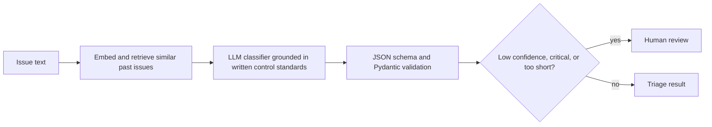
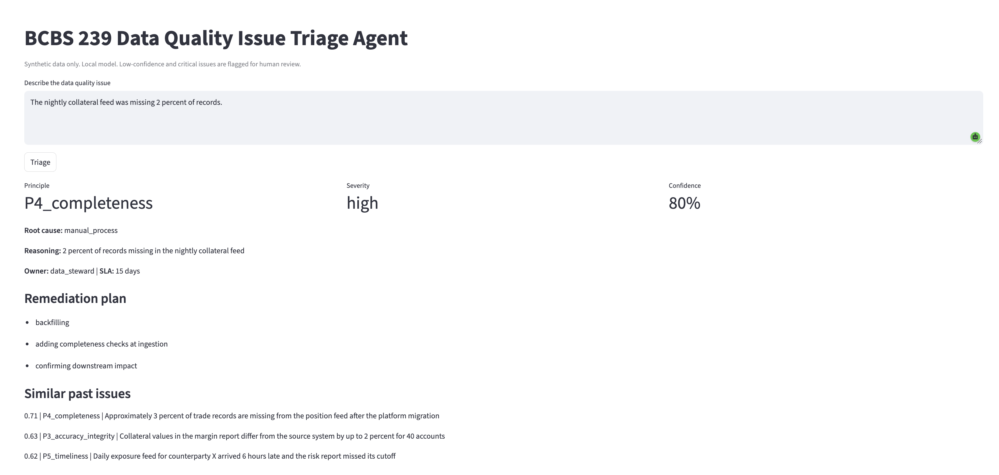
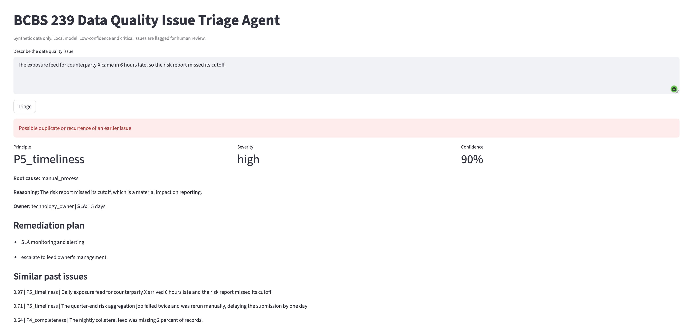
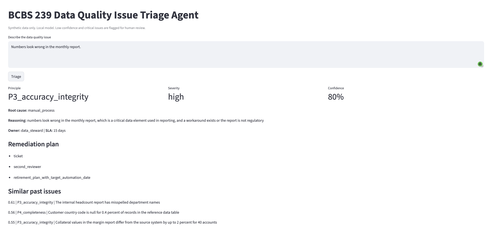
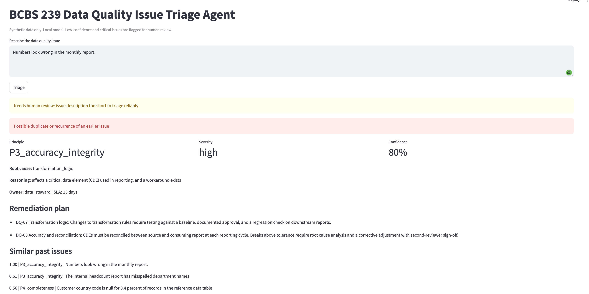

# Evaluating an LLM Triage Agent for BCBS 239 Data Quality Issues: A Case Study

A local LLM agent was built to triage data quality issues against BCBS 239 principles (principle, severity, root cause, remediation, duplicate check, human-review flag). It looked good on synthetic labels. Against a hand-verified gold set it failed its own pre-registered pass bar, and the investigation showed why.

**Status: research prototype. Not fit for use.** The value of this repository is the evaluation record, not the agent.

> **Data note:** every issue in this repository is synthetic. No employer or client data, anonymized or otherwise, was used. Generation method: [FILL IN: how the synthetic rows were generated, tool or model and prompt approach].

## Summary of findings

1. **Scoring against synthetic labels overstated principle accuracy by 26 points.** The agent matched the synthetic labels 92% of the time but matched my hand labels 66% of the time.
2. **The severity labels were under-specified.** Three sources (my labels, the synthetic labels, the agent) agreed with each other only 41 to 43% of the time on severity. A rubric that leaves cases undecided caps what any model can score.
3. **The agent defaulted to the most common answer.** It predicted "high" for 107 of 119 issues. Its 43% severity accuracy equals the score of always answering "high".
4. **It never produced "critical" and caught 0 of 21 critical issues**, and none of those reached a human-review flag. Because the review flag depended on critical severity or self-reported confidence, the safety net had a hole exactly where it mattered.
5. **A classifier trained on the synthetic labels reached 62% critical recall but only 31% precision**, because it reproduced the generator's tendency to over-rate severity.
6. **Self-reported confidence was not usable.** A vague input ("Numbers look wrong in the monthly report") came back with 80% confidence.

## Pre-registered pass bar and outcome

The bar was written and committed before the gold evaluation (`evals/PASS_BAR.md`). Both systems failed every criterion.

| Criterion | Bar | Agent v2 | Embedding + logistic regression |
|---|---|---|---|
| Critical recall | >= 85% | 0/21 (0%) | 13/21 (62%) |
| Severity accuracy | >= 75% | 43% | 31% |
| Principle accuracy | >= 85% | 66% | 72% |
| Under-triage rate | <= 10% | 25% | 30% |
| Critical issues with no critical label and no review flag | <= 10% | 21/21 | not applicable (no review mechanism) |

## What was built

- Local model `llama3.1:8b` and `nomic-embed-text` through Ollama, so no data leaves the machine.
- Output constrained to a JSON schema and validated with Pydantic.
- Severity, SLA, and remediation grounded in a fictional written control standard (`data/policies.md`).
- Duplicate detection by embedding similarity (threshold 0.78, calibrated on a few example pairs: reworded duplicate 0.82, same theme different feed 0.71).
- Human-review flag on low confidence, critical severity, or an input too short to triage (the last added after the overconfidence failure below).
- Streamlit UI. Everything is free and runs on a laptop.

Screenshots: normal result, duplicate detection, the overconfidence failure, and the input-length guard.

## Evaluation timeline

**Stage 1: 15 hand-written issues.** Baseline severity accuracy was 67%. After I rewrote the severity rubric as a decision order, it rose to 87%, but I wrote the rubric after seeing the failures, so that number is optimistic and is reported as a tuned result.

**Stage 2: 6 held-out hand-written issues.** Principle 67%, severity 50%. The tuned gain did not carry over, which showed that part of it was fitting to the 15 examples. The model never output "critical" here either.

**Stage 3: about 6,000 synthetic rows (train, validation, test) and a 120-row gold set.** I validated and deduplicated the data, removed rows too similar across splits, and sampled 120 rows from the locked test split with critical cases oversampled. I labeled them myself, blind to the synthetic labels. All stage 3 numbers below come from this gold set. Cleaning counts are in `evals/prep_report.txt`.

## Results

| System | Eval set | Principle acc. | Severity acc. | Critical recall |
|---|---|---|---|---|
| Agent v1 (baseline) | 15 hand-written | 93% | 67% | not measured |
| Agent v2 (tuned rubric) | same 15 (tuned on) | 93% | 87% | not measured |
| Agent v2 | 6 held-out | 67% | 50% | 0 of 2 |
| Agent v2 | gold set (n=119) | 66% | 43% | 0/21 |
| Embedding + logistic regression | gold set (n=120) | 72% | 31% | 13/21 |
| Always answer "high" | gold set (n=119) | not applicable | 43% | 0/21 |

Agent v2 was scored on 119 of 120 rows. One row crashed on a runaway generation (about 125,000 characters of invalid JSON) and is excluded.

## Findings in detail

### 1. Synthetic labels flattered the agent

| Comparison (same 120 rows) | Principle | Severity |
|---|---|---|
| My labels vs synthetic labels | 72% | 41% |
| Agent vs my labels | 66% | 43% |
| Agent vs synthetic labels | 92% | 41% |

The agent is a language model and so is the generator that wrote the rows. The data is also heavily templated (many rows share a sentence skeleton such as "Lineage documentation for the X field stops at the Y with no documented link to Z"). Matching the generator's labels is therefore much easier than matching a human reading. This is a likely explanation, not a proven one.

Rows the generator itself marked as ambiguous (n=14) matched my principle label only 14% of the time. On the other 106 rows it was 79%. Headline principle numbers should use the non-ambiguous rows.

### 2. Severity was under-specified

My severity labels disagreed with the synthetic ones on 71 of 120 rows. In 47 of the 71 the synthetic label was more severe than mine (synthetic high vs my medium: 20, critical vs high: 18, critical vs medium: 9). The generator rated systematically higher than my reading of the standard.

Reading the disputed rows against the standard, five questions were left open by the rubric:

| # | Open question | Example |
|---|---|---|
| 1 | If an issue does not mention a workaround, is there one? | RWA totals changed, no regression test |
| 2 | Which reports count as regulatory? | "daily risk report", "credit risk return" |
| 3 | Are control or documentation gaps with no known numeric error high or medium? | lineage documentation stops short, no single owner |
| 4 | Is a blank mandatory field above 1% critical or high? | 6.9% of risk weight values blank |
| 5 | Is chronic timeliness rated by report impact or by frequency? | SLA breached on 7 of 30 days |

This is an analysis of the disputed rows, not a measured result. I did not run the follow-up relabel under a written guide, so I cannot say how much agreement would improve.

### 3. The agent collapsed to the majority answer

Predicted severity distribution on the gold set: 107 high, 10 low, 2 medium, 0 critical. Of my 21 critical rows, all 21 were called high. Of my 46 medium rows, 38 were called high.

### 4. The safety net depended on the thing that failed

Human review fired on critical severity or on low self-reported confidence. The agent never produced critical, and confidence was uninformative (80% on a near-empty input, 90% on a wrong severity). All 21 critical issues therefore bypassed human review. A deterministic input-length guard was added after the vague-input failure, but it does not address this weakness.

### 5. Training a classifier on the synthetic labels reproduced their bias

The classifier's principle accuracy (72%) equals my agreement with the synthetic labels (72%). It learned the generator's habits and cannot score above them. It predicted critical 42 times and was right 13 times, calling 22 of my "high" rows critical. With only 21 critical rows, the 62% recall estimate is wide (roughly 38% to 82% for a 95% interval). Both systems are poor on severity, for opposite reasons: the agent under-calls, the classifier over-calls.

### 6. Reliability

One run produced an unbounded generation that failed validation. The retries repeated the same temperature-0 call, so they could not recover. Capping generated tokens and varying temperature or seed on retry is the fix. Separately, numpy emitted RuntimeWarnings (divide by zero, overflow in matmul) during the classifier run, and the result was not re-verified in float64.

## What this case illustrates

- Synthetic labels from a model of the same family as the system under test inflate scores. Keep a small human-verified gold set and report both numbers.
- If labelers cannot agree, the model cannot be graded fairly. Measure agreement first, and treat low agreement as a defect in the specification.
- Accuracy hides the dangerous failure. Report recall on the rare high-impact class, and under-triage separately from over-triage.
- Self-reported model confidence is not a control. Escalation logic should rest on deterministic checks.
- Writing the pass bar before running the evaluation made it possible to say "failed" without argument.

## Limitations of this evaluation

- One labeler, 120 rows, 21 critical rows, 1 low row. The gold set oversamples critical, so its severity mix does not match a real queue.
- Single 8B model; no comparison with other models or prompts beyond the rubric rewrite.
- No second labeler and no repeat labeling by me, so human agreement is not measured.
- The synthetic data is templated, so its effective diversity is far below its row count.
- The duplicate-detection threshold was calibrated on a handful of pairs and not evaluated at scale.
- Root cause and remediation quality were not evaluated. In spot checks the root cause often defaulted to `manual_process`, and one remediation plan echoed policy field names instead of giving steps.

## What I would do next (not done)

1. Write a severity labeling guide that answers the five open questions, committed before any relabeling.
2. Relabel the gold set blind under the guide, after a delay, and report my agreement with my own first pass.
3. Redesign severity so the model extracts yes/no facts (regulatory report affected, change untested, workaround stated, and so on) and code applies the written rule. This makes severity deterministic, testable, and auditable.
4. Evaluate on a fresh unseen sample with a second labeler, and report critical recall with an interval.
5. Add an audit log of every run, a classifier-versus-agent disagreement flag, and a model card.

## Run it

    python3 -m venv .venv
    source .venv/bin/activate
    pip install -r requirements.txt
    ollama pull llama3.1:8b
    ollama pull nomic-embed-text
    streamlit run app.py

Evaluations:

    python -m evals.run_eval data/labeled.json
    python -m evals.run_eval data/heldout.json
    python -m evals.run_gold data/gold.json agent_v2
    python -m evals.gold_classifier data/gold.json

## Evidence index

| File | Contents |
|---|---|
| `evals/PASS_BAR.md` | Pass bar, committed before the gold evaluation |
| `evals/results_baseline.txt`, `results_v2.txt`, `results_heldout.txt` | Stage 1 and 2 outputs |
| `evals/prep_report.txt` | Validation, deduplication, and leakage counts for the synthetic data |
| `evals/gold_agreement.txt` | My labels vs synthetic labels |
| `evals/results_gold_agent_v2.txt`, `evals/preds_agent_v2.json` | Agent on the gold set, with per-row predictions |
| `evals/results_gold_classifier.txt` | Classifier on the gold set |
| `evals/diagnose_gold.txt` | Three-way agreement and example disputed rows |
| `data/policies.md` | The fictional control standard the agent was grounded in |
| `data/gold.json` | The 120 hand-labeled gold rows |

## Layout

    src/       agent, LLM helpers, schema, issue log, data loading
    data/      control standards, synthetic splits, gold set
    evals/     evaluation scripts and saved results
    scripts/   data preparation and diagnostics
    docs/      screenshots
    app.py     Streamlit UI
