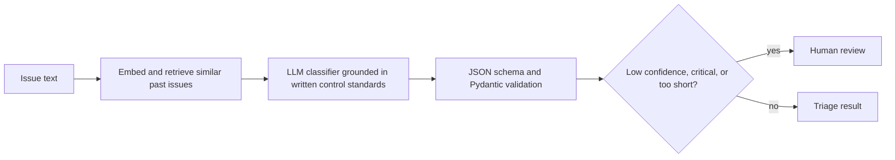

# BCBS 239 Data Quality Issue Triage Agent

A local, agentic prototype that triages data quality issues against BCBS 239 principles. For each issue it returns the principle, severity, root cause, a remediation plan, a duplicate/recurrence check against past issues, and a human-review flag.

> **Data note:** every issue in this repository is synthetic and written for this demo. No employer or client data, anonymized or otherwise, was used.

## Problem

Data quality issue queues are triaged by hand, and the same issue is often classified and prioritized differently depending on who picks it up. This prototype tests how far a small local model can go in making first-pass triage consistent, and where it still needs a human.

## How it works

1. The issue is embedded (`nomic-embed-text`) and compared with logged issues. A similarity of 0.78 or higher raises a possible-duplicate flag.
2. `llama3.1:8b` classifies the issue, using a policy file (`data/policies.md`) as the only source for severity, SLA, and remediation. Output is constrained to a JSON schema and validated with Pydantic.
3. Governance flags are added: low model confidence, critical severity, or an issue description too short to triage reliably send the issue to human review.

Everything runs locally through Ollama, so no data leaves the machine.

## Screenshots

Normal result:

Duplicate detection:

Failure case: a vague input with an overconfident answer (80% confidence, no review flag):

After adding a deterministic input-length guard:

## Evaluation

| Run | Issues | Principle accuracy | Severity accuracy |
|---|---|---|---|
| Baseline | 15 | 93% | 67% |
| v2 (decision-order severity rubric) | 15 | 93% | 87% |
| v2 on held-out issues | 6 | 67% | 50% |

Raw outputs are in `evals/`.

What the results show:

- **The v2 gain was partly overfitting.** I rewrote the severity rubric after seeing baseline failures, so the 87% on the same 15 issues is optimistic. The 6 held-out issues, which were not used for tuning, scored 50% on severity.
- **Critical issues are under-triaged.** Across all three runs the model never output "critical". Four issues labeled critical were all called "high".
- **The review flag has a weakness.** Because severity is never "critical", that trigger rarely fires, and the confidence trigger relies on the model judging itself. A vague input ("Numbers look wrong in the monthly report") came back with 80% confidence. I added a deterministic minimum-length guard as a partial fix.
- **Some labels are debatable.** A retired field name in a report footnote (accuracy vs. lineage) and a missing counterparty grouping (adaptability vs. architecture) could reasonably go either way.
- **Root cause and remediation quality were not evaluated.** In spot checks the root cause defaulted to `manual_process`, and one remediation plan echoed policy tokens instead of giving real steps.

## Governance and model risk notes

- Local model: no data leaves the machine.
- Structured output is enforced by JSON schema and validated; invalid outputs are retried, then fail loudly.
- Remediation and SLA come from a written control standard, not from model memory.
- Escalation to a human is built in, with the reason shown to the reviewer.
- Known limitation: the confidence value is self-reported by the model and should not be treated as calibrated.

## Limitations

- Small evaluation sets (15 tuned, 6 held-out), labeled by one reviewer.
- The duplicate threshold was calibrated on a handful of example pairs.
- 8B-parameter model, JSON file as the issue log, no reviewer feedback loop.
- Severity is predicted directly by the model. A more auditable design would extract facts (regulatory report affected, workaround exists, critical data element affected) and compute severity in code from the control standard. This is the next planned iteration, to be evaluated on a fresh held-out set.

## Path to production

Integration with an issue management tool, audit logging of every model output and reviewer decision, independent model validation, drift monitoring, a reviewer feedback loop, and calibration of the duplicate and confidence thresholds on real labeled data.

## Run it

    python3 -m venv .venv
    source .venv/bin/activate
    pip install -r requirements.txt
    ollama pull llama3.1:8b
    ollama pull nomic-embed-text
    python -c "import json; from src.agent import triage; [triage(d['text']) for d in json.load(open('data/labeled.json'))]"
    streamlit run app.py

Run the evaluations:

    python -m evals.run_eval data/labeled.json
    python -m evals.run_eval data/heldout.json

## Repository layout

    src/      agent, LLM helpers, schema, issue log
    data/     control standards, labeled and held-out synthetic issues
    evals/    evaluation script and saved results
    docs/     screenshots
    app.py    Streamlit UI
